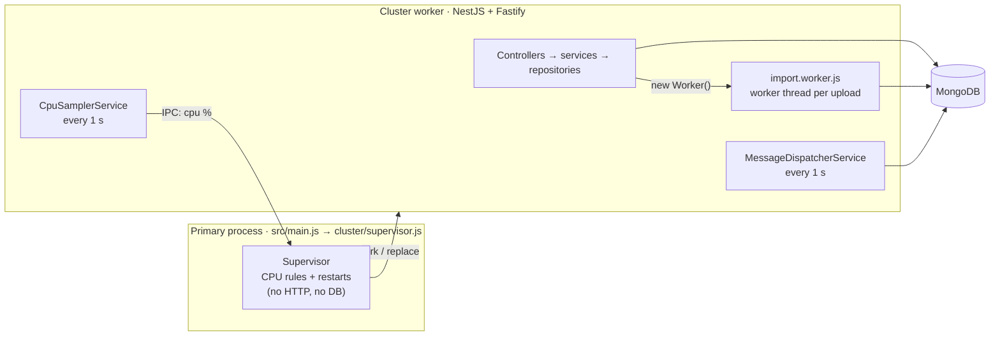

# customer.api

An insurance policy data service built for the Node.js assessment. It:

- imports the provided CSV/XLSX sheet into MongoDB on a worker thread
- searches policies by user name
- aggregates policies for each user
- restarts the server when CPU passes 70 %
- inserts scheduled messages at a requested day and time

The code is **JavaScript** (CommonJS) on **NestJS 11 + Fastify**, with **MongoDB / Mongoose 9**, on Node.js ≥ 22.9.

| Task | What it does | Where |
|---|---|---|
| 1.1 | Upload XLSX/CSV into MongoDB using worker threads | `POST /api/uploads` → [`import.worker.js`](src/modules/uploads/workers/import.worker.js) |
| 1.2 | Search policy info by username | `GET /api/policies/search?username=` |
| 1.3 | Aggregated policies by each user | `GET /api/policies/aggregate/by-user` |
| 1.4 | Agent, User, Account, LOB, Carrier, Policy as separate collections | [`src/common/schemas/models`](src/common/schemas/models) |
| 2.1 | Track CPU in real time and restart the server at 70 % | [`src/cluster/supervisor.js`](src/cluster/supervisor.js) + [`cpu-sampler.service.js`](src/modules/health/cpu-sampler.service.js) |
| 2.2 | POST message + day + time; insert it into the DB at that moment | `POST /api/messages/schedule` + [`message-dispatcher.service.js`](src/modules/messages/message-dispatcher.service.js) |

With the sample sheet, the import produces **3 agents, 19 LOBs, 46 carriers, 1,198 users, 1,198 accounts and 1,198 policies**. Uploading it again creates nothing new.

---

## Quick start

Prerequisites: Node.js ≥ 22.9 (24 LTS recommended), pnpm 11 (`corepack enable` provides it), and MongoDB 6 or newer, running locally or via Docker (`docker run -d -p 27017:27017 mongo:8`).

```bash
pnpm install
cp .env.example .env          # data goes to the "customer" database; set MONGO_URI if your server differs
pnpm build
pnpm start                    # cluster mode: supervisor + 1 server worker on :3000
```

pnpm 11 only runs dependency install scripts that are approved in [`pnpm-workspace.yaml`](pnpm-workspace.yaml). Only `mongodb-memory-server` is allowed; it downloads the MongoDB binary for the tests.

Then try it:

```bash
curl -F "file=@data/sample.csv" http://localhost:3000/api/uploads
curl "http://localhost:3000/api/policies/search?username=lura"
curl "http://localhost:3000/api/policies/aggregate/by-user?page=1&limit=5"
curl -H "Content-Type: application/json" -d '{"message":"Policy renewal reminder","day":"friday","time":"10:00"}' http://localhost:3000/api/messages/schedule
```

A Postman collection with every request is in [`postman/`](postman/customer-api.postman_collection.json).

| Script | Purpose |
|---|---|
| `pnpm build` | Compile `src/` to `dist/` with Babel (decorators only) |
| `pnpm start` | Run `dist/main.js` (reads `.env` if present) |
| `pnpm start:dev` | Run from `src/` with Babel on the fly and `--watch` |
| `pnpm test` | Unit + end-to-end tests (87), against a real in-memory `mongod` |
| `pnpm demo:cpu` | Live demo of the CPU auto-restart (needs `MONGO_URI`) |

---

## API

Every response uses one envelope:

```json
{ "status": "success", "code": 200, "msg": "…", "data": { } }
{ "status": "failed",  "code": 400, "msg": "username is required", "data": { "details": ["username is required"] } }
```

| Method | Path | Purpose |
|---|---|---|
| POST | `/api/uploads` | Upload a `.csv` / `.xlsx` sheet (multipart field `file`, ≤ 10 MB) and import it |
| GET | `/api/policies/search?username=&page=&limit=` | Policies of every user whose name contains `username` |
| GET | `/api/policies/aggregate/by-user?page=&limit=&userId=` | Policies aggregated per user |
| POST | `/api/messages/schedule` | Schedule a message insert at `day` + `time` |
| GET | `/api/messages/schedule/:id` | Status of a scheduled message |
| GET | `/api/messages?page=&limit=` | Messages inserted so far, newest first |
| GET | `/health` | PID, uptime, DB state and the latest CPU sample |
| POST | `/api/debug/cpu-burn` | Dev-only CPU load generator (`ENABLE_DEBUG_ROUTES=true`) |

### POST /api/uploads — Task 1.1

```bash
curl -F "file=@data/sample.csv" http://localhost:3000/api/uploads
```

```json
{
  "status": "success", "code": 200, "msg": "Import completed",
  "data": {
    "file": "sample.csv", "durationMs": 1690,
    "rowsRead": 1198, "rowsImported": 1198, "rowsSkipped": 0,
    "collections": {
      "agents":   { "inserted": 3,    "matched": 0 },
      "lobs":     { "inserted": 19,   "matched": 0 },
      "carriers": { "inserted": 46,   "matched": 0 },
      "users":    { "inserted": 1198, "matched": 0 },
      "accounts": { "inserted": 1198, "matched": 0 },
      "policies": { "inserted": 1198, "matched": 0 }
    },
    "errors": []
  }
}
```

Bad rows are skipped and reported, and the rest of the file is still imported: `"errors": [{ "row": 3, "field": "policy_start_date", "message": "expected YYYY-MM-DD" }]`. At most 100 errors are returned; the header is row 1.

| Status | When |
|---|---|
| 400 | No file, a type other than `.csv`/`.xlsx`, or required columns missing (the response lists them) |
| 413 | File larger than `UPLOAD_MAX_BYTES` |
| 422 | The file can't be parsed, has no data rows, or none of its rows is valid |
| 429 | `IMPORT_MAX_CONCURRENCY` imports are already running |

### GET /api/policies/search — Task 1.2

This is a case-insensitive substring match on the user's name (the sheet's `firstname` column holds the full name). Regex characters in the input are escaped, so `.*` matches literally.

```bash
curl "http://localhost:3000/api/policies/search?username=lura"
```

```json
{
  "status": "success", "code": 200, "msg": "Found 1 policy",
  "data": {
    "pagination": { "page": 1, "limit": 20, "total": 1, "totalPages": 1 },
    "policies": [{
      "id": "…", "policyNumber": "YEEX9MOIBU7X",
      "policyStartDate": "2018-11-02T00:00:00.000Z", "policyEndDate": "2019-11-02T00:00:00.000Z",
      "policyType": "Single", "policyMode": 12, "premiumAmount": 1180.83,
      "category": { "id": "…", "categoryName": "Commercial Auto" },
      "carrier":  { "id": "…", "companyName": "Integon Gen Ins Corp" },
      "agent":    { "id": "…", "name": "Alex Watson" },
      "user":     { "id": "…", "firstName": "Lura Lucca", "email": "madler@yahoo.ca" }
    }]
  }
}
```

`username=kenneth` returns 6 policies.

### GET /api/policies/aggregate/by-user — Task 1.3

Each user gets a policy count, a premium total, the first start and last end date, and the policy list with category and carrier names. Users are sorted by policy count, then name. Pass `userId` to get one user.

```json
{
  "status": "success", "code": 200, "msg": "",
  "data": {
    "pagination": { "page": 1, "limit": 20, "total": 1198, "totalPages": 60 },
    "users": [{
      "userId": "…", "firstName": "Lura Lucca", "email": "madler@yahoo.ca",
      "policyCount": 1, "totalPremium": 1180.83,
      "firstPolicyStart": "2018-11-02T00:00:00.000Z", "lastPolicyEnd": "2019-11-02T00:00:00.000Z",
      "policies": [{ "policyNumber": "YEEX9MOIBU7X", "category": "Commercial Auto", "carrier": "Integon Gen Ins Corp",
                     "policyStartDate": "2018-11-02T00:00:00.000Z", "policyEndDate": "2019-11-02T00:00:00.000Z", "premiumAmount": 1180.83 }]
    }]
  }
}
```

Across all 1,198 users, `totalPremium` adds up to **3,339,088.92**, the total of the sheet's `premium_amount` column.

### POST /api/messages/schedule — Task 2.2

```json
{ "message": "Policy renewal reminder", "day": "2026-10-05", "time": "14:30", "timezone": "Asia/Kolkata" }
```

| Field | Required | Format |
|---|---|---|
| `message` | yes | Non-empty string, ≤ 1,000 characters |
| `day` | yes | `YYYY-MM-DD`, **or** a weekday name (`monday` … `sunday`), which means its next occurrence. Today counts if the time is still ahead. |
| `time` | yes | 24-hour `HH:mm` or `HH:mm:ss` |
| `timezone` | no | IANA zone; defaults to `APP_TIMEZONE` (`Asia/Kolkata`) |

The request returns **201** with the job:

```json
{
  "status": "success", "code": 201, "msg": "Message scheduled",
  "data": { "id": "…", "message": "Policy renewal reminder", "status": "pending",
            "runAt": "2026-10-05T09:00:00.000Z", "timezone": "Asia/Kolkata",
            "requested": { "day": "2026-10-05", "time": "14:30" }, "attempts": 0,
            "processedAt": null, "messageId": null, "lastError": null }
}
```

When the time comes, the message is inserted into `messages` and the job becomes `done`. You can watch it through `GET /api/messages/schedule/:id` and `GET /api/messages`. An impossible date (`2026-02-30`), a malformed time, an unknown zone or a moment in the past returns **400**.

---

## How it works



**Task 1.1: import on worker threads.** The upload is streamed to a temp file. A dedicated worker thread (`node:worker_threads`) then parses it, normalises each row and bulk-upserts in batches of 1,000, in dependency order: agents, LOBs and carriers, then users, then accounts and policies. The request awaits the worker without blocking the event loop, and a test proves `/health` still answers mid-import.

Every collection has a unique natural key, so re-uploading is idempotent:

| Collection | Unique key |
|---|---|
| agents | `name` |
| lobs | `categoryName` |
| carriers | `companyName` |
| users | `firstName + email` |
| accounts | `userId + accountName` |
| policies | `policyNumber` |

XLSX dates are converted from Excel serials with `XLSX.SSF.parse_date_code`. Going through a JS `Date` would move every date back one day in time zones east of UTC, including IST.

**Task 1.2 / 1.3: search and aggregation.** Search resolves matching users, then returns their policies with category, carrier, agent and user populated. The aggregation is a single pipeline: `$lookup` LOB and carrier → `$group` by user → `$lookup` user → sort → `$facet` for the page and the count.

**Task 2.1: CPU monitor.** Each server process measures its own CPU every second, as `Δ(user + system CPU time) / Δ(wall time)` (100 % = one core, like `top`), and sends it over IPC to the cluster primary. The primary does no HTTP or DB work, so it can always act. A server whose event loop is pegged can't run its own timers, which is why the decision lives in another process.

| Rule | Action |
|---|---|
| CPU ≥ `CPU_THRESHOLD_PCT` (70) for `CPU_SUSTAIN_SAMPLES` (3) consecutive samples | Fork a replacement. Once it's listening, ask the old worker to drain and exit over IPC, with `SIGKILL` after `SHUTDOWN_TIMEOUT_MS`. |
| No sample for `CPU_HEARTBEAT_TIMEOUT_MS` (5 s): the event loop is blocked | Fork a replacement, then `SIGKILL` the old worker |
| First `CPU_WARMUP_MS` after a fork | Ignored (boot spike) |
| More than `RESTART_MAX` restarts in `RESTART_WINDOW_MS` | Circuit breaker: log and stop restarting |

**Task 2.2: scheduled messages.** Jobs are stored in `scheduled_messages`, never held in in-memory timers. Timers would die with the process (Task 2.1 restarts it on purpose), and `setTimeout` fires immediately for delays over about 24.8 days. A dispatcher in every server process polls every second:

1. Release stale locks.
2. Claim due jobs atomically with `findOneAndUpdate`.
3. Insert into `messages`, using a unique `scheduledMessageId` so a retry can never insert twice.

A message is inserted within about a second of its time; the logs show about 0.1 s of lag. Jobs that came due during a restart run right after boot.

### Project layout

The layout follows the service blueprint: modules, then controller → service → repository.

```
src/
├── main.js                  # entry: cluster primary → supervisor, worker → NestJS app
├── bootstrap.js             # createApp(): Fastify, helmet, multipart, prefix, logging, graceful shutdown
├── app.module.js
├── config/                  # Joi-validated env → AppConfigService (the only place reading process.env)
├── cluster/                 # Task 2.1: supervisor + pure restart-policy rules
├── common/
│   ├── schemas/             # plain Mongoose schemas, model registry, aggregation queries, index bootstrap
│   ├── database/            # BaseRepository, owned repositories, bulkUpsert
│   ├── interceptors/ filters/ pipes/ dto/ logger/ utils/
└── modules/
    ├── uploads/             # Task 1.1: controller, service (worker orchestration), import pipeline, worker
    ├── policies/            # Task 1.2 + 1.3
    ├── messages/            # Task 2.2: API, day/time resolution, dispatcher
    ├── health/              # /health + CPU sampler
    └── debug/               # cpu-burn demo route (off by default)
```

**Why JavaScript with Babel.** The brief requires JavaScript, and NestJS relies on decorators, which Node doesn't run natively yet. Babel compiles only the decorators and decorated class fields; everything else is plain CommonJS. Dependency injection uses `@Dependencies()` and parameters use `@Bind()`, as in NestJS's JavaScript mode. DTO validation binds the class explicitly (`ValidBody(Dto)` / `ValidQuery(Dto)`), because plain JavaScript has no parameter type metadata. Files used by the worker thread have no decorators, so it loads them straight from `src/` in dev and tests.

---

## Configuration

All variables are validated at startup; an invalid value stops the process with a clear message. See [`.env.example`](.env.example) for the full list.

| Variable | Default | Meaning |
|---|---|---|
| `MONGO_URI` | *(required)* | MongoDB connection string |
| `MONGO_DB_NAME` | `customer` | Database to use, even if `MONGO_URI` names another one (or none) |
| `PORT` / `HOST` | `3000` / `0.0.0.0` | HTTP listener |
| `CLUSTER_ENABLED` / `WEB_CONCURRENCY` | `true` / `1` | Supervisor + number of server workers (`false` = single process, no auto-restart) |
| `UPLOAD_MAX_BYTES` | `10485760` | Upload size limit |
| `IMPORT_BATCH_SIZE` / `IMPORT_MAX_CONCURRENCY` / `IMPORT_TIMEOUT_MS` | `1000` / `2` / `120000` | Worker-thread import |
| `CPU_THRESHOLD_PCT` / `CPU_SUSTAIN_SAMPLES` / `CPU_SAMPLE_MS` | `70` / `3` / `1000` | Restart rule |
| `CPU_HEARTBEAT_TIMEOUT_MS` / `CPU_WARMUP_MS` | `5000` / `10000` | Blocked-loop detection / boot grace |
| `RESTART_MAX` / `RESTART_WINDOW_MS` / `SHUTDOWN_TIMEOUT_MS` | `5` / `60000` / `10000` | Circuit breaker / graceful drain |
| `APP_TIMEZONE` | `Asia/Kolkata` | Default zone for `day` + `time` |
| `SCHEDULER_POLL_MS` / `SCHEDULER_LOCK_TTL_MS` / `SCHEDULER_MAX_ATTEMPTS` | `1000` / `30000` / `5` | Dispatcher |
| `CORS_ORIGINS` | *(empty = off)* | Comma-separated allow-list |
| `ENABLE_DEBUG_ROUTES` | `false` | Enables `POST /api/debug/cpu-burn` |

---

## Tests

```bash
pnpm test
```

There are 87 tests: 47 unit and 40 end-to-end. The end-to-end tests start the real NestJS app against a real `mongod` from mongodb-memory-server, whose binary is cached on first install. To use your own server instead, set `TEST_MONGO_URI=mongodb://127.0.0.1:27017`; each test file uses and then drops its own `customer_test_*` database, never the real `customer` one.

- **Import:** the exact counts, idempotent re-upload, an XLSX with real date cells matching the CSV, the sheet's quirks (quoted commas, phone extensions, `27104-____` ZIPs), bad rows, missing columns, the size limit, and the API staying responsive during an import.
- **Search:** case-insensitive matching, the 6 "kenneth" policies, pagination, regex escaping and validation.
- **Aggregation:** 1,198 groups, the 3,339,088.92 premium total, single-user output, a user with several policies, and ordering.
- **Scheduler:** UTC conversion, weekday names, every validation error, no early inserts, two dispatchers racing over 20 due jobs plus a stale lock (exactly 21 messages), and idempotent replays.
- **Supervisor:** the pure restart rules (warm-up, streaks, heartbeat, circuit breaker).

## Demo: CPU auto-restart (Task 2.1)

```bash
pnpm build
pnpm demo:cpu
```

The script starts the server in cluster mode with the debug route on and burns CPU twice. Output from a real run:

```
▶ yield: server worker pid 4032; starting a 30 s "yield" CPU burn
  pid 4032  cpu  70.1 %  event loop  72.8 %
  pid 4032  cpu  99.6 %  event loop   100 %
{"level":40,…,"name":"supervisor","workerPid":4032,"reason":"cpu 88.6% >= 70% for 3 consecutive samples","msg":"restarting server worker"}
✓ yield: replaced pid 4032 → 17104 after 5.0 s (health checks: 9 ok, 0 failed)

▶ block: server worker pid 17104; starting a 30 s "block" CPU burn
{"level":40,…,"name":"supervisor","workerPid":17104,"reason":"no CPU sample for 5055 ms (event loop blocked)","msg":"restarting server worker"}
✓ block: replaced pid 17104 → 11100 after 6.6 s (health checks: 1 ok, 4 failed)
```

The yielding burn is replaced with no failed requests. The blocking burn can't serve while it's frozen, so the supervisor bounds that outage to the heartbeat timeout.

---

## Assumptions

The brief leaves some points open. These are the choices made, each easy to change:

1. **"Restart at 70 %"** means the Node process's CPU, per core (as in `top`), not the whole machine's. On an 8-core machine a fully pegged Node process is 12.5 % machine-wide and would never trip a machine-wide rule. `/health` reports both values.
2. **`day`** accepts a calendar date or a weekday name. A weekday means its next occurrence, one-off (not weekly).
3. **The time zone** for `day` + `time` defaults to `Asia/Kolkata` and can be overridden per request.
4. **"Username"** is the `firstname` column, which holds the person's full name, matched case-insensitively.
5. **User identity** is `firstname + email`. Email alone is shared by different people in the sheet (47 addresses). An account belongs to one user, because 5 account names are shared by two people.
6. **Carriers ending in `_Copy`** (e.g. `Nationwide Mut Ins Co_Copy`) are kept as separate carriers (46). Merging them would give 40.
7. **Extra columns** (premium, term, policy type, producer, CSR, account type, city) are stored too, so the import is lossless. Only the 5 always-empty columns are dropped.
8. **The upload** answers synchronously with a summary. The sample takes about 2 s.

[`docs/DESIGN.md`](docs/DESIGN.md) has the full data profile and design notes.
